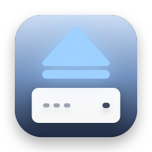
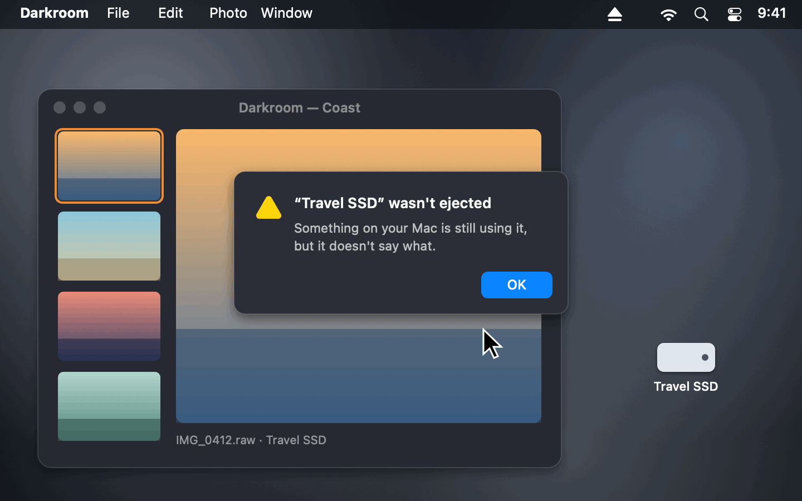
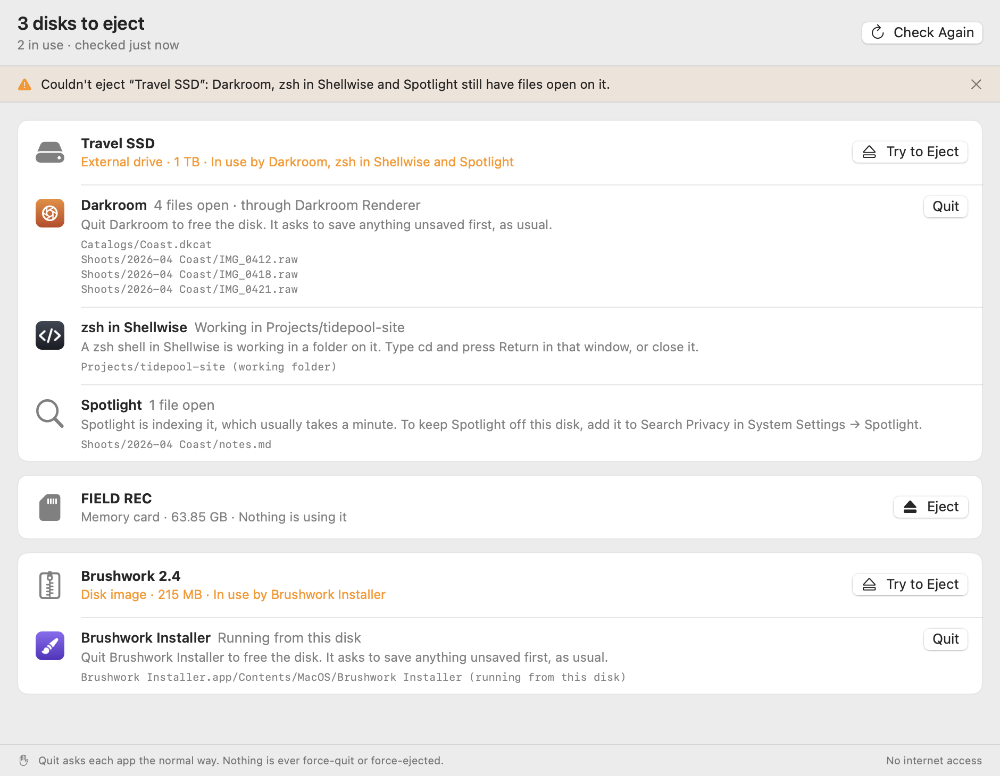

<p align="center">
  
</p>

<h1 align="center">Unblock Eject</h1>

<p align="center">
  <b>See what's keeping your disk from ejecting.</b><br>
  A free, open-source menu bar app that names the apps and processes with files open on your external drives, memory cards and disk images, quits the one you choose the normal way, and ejects.
</p>

<p align="center">
  <a href="https://github.com/stanczykwyatt/unblock-eject/releases/latest/download/Unblock-Eject.zip"><b>Download for Mac</b></a>
  &nbsp;·&nbsp;
  <a href="https://stanczykwyatt.github.io/unblock-eject/">Website</a>
  &nbsp;·&nbsp;
  <a href="https://github.com/users/stanczykwyatt/projects/1">Roadmap</a>
  &nbsp;·&nbsp;
  <a href="https://github.com/stanczykwyatt/unblock-eject/discussions">Discussions</a>
</p>

<p align="center">
  <a href="https://github.com/stanczykwyatt/unblock-eject/actions/workflows/ci.yml"></a>
  <a href="https://github.com/stanczykwyatt/unblock-eject/releases/latest"></a>
  
  
  
  
  
  <a href="LICENSE"></a>
</p>

<p align="center">
  
</p>

---

*"The disk wasn't ejected because one or more programs may be using it."* Which programs? macOS doesn't say. So you quit apps one by one and try again, or look up how to use `lsof` in Terminal, or force eject and hope nothing was halfway through writing.

Unblock Eject tells you. Click its menu bar icon and every disk you can eject is listed with whatever has files open on it: the app, with its icon, and the files it has open. An app you can quit gets a Quit button, which asks it to quit the normal way, so it can still ask you to save. A shell sitting in a folder on the disk, Spotlight indexing it, Time Machine backing up to it or a disk image stored on it that's still open each get a plain explanation of what to do instead. When the disk is free, eject it from the same menu.

It never force-quits, never force-ejects, and never quits or ejects anything you didn't click. It needs no permissions, has no internet access, and is open source, so you can see exactly what it does.

If it saves you a round of guessing, [starring the repo](https://github.com/stanczykwyatt/unblock-eject/stargazers) helps other people find it.

<picture>
  <source media="(prefers-color-scheme: dark)" srcset="docs/screenshot-dark.png">
  
</picture>

## Features

- **Names what's using each disk.** Every app and process with a file open on an external drive, memory card or disk image, with its icon and the files, shown from the top of the disk, like `Photos/beach.raw`.
- **Groups helpers with their app.** A browser's renderer or an editor's background helper shows up as the app you know, with one Quit button for all of it.
- **Quits politely, only when you click.** Quit sends the app the same request as choosing Quit from its own menu, so it asks to save your work first or says no. Nothing is ever force-quit.
- **Explains what it can't quit.** A shell `cd`'d into the disk, a command still running in a terminal, Spotlight indexing, Time Machine backing up, Quick Look making thumbnails, a Photos or Music library, a disk image stored on the disk, a malware check on an app there, and Finder in the middle of a copy each get a sentence saying what to do.
- **Ejects once it's free.** The whole drive, every volume on it, the way Finder does. Disk images are detached too. While anything still has a file open on it, macOS refuses.
- **Says why an eject failed.** Eject from Unblock Eject and, if it can't, the window opens with exactly what's in the way.
- **A command line tool,** `unblock-eject`, that prints the same list, or JSON, for any disk or path. It only looks.
- **Light on your Mac.** It checks when you open the menu, when a disk comes or goes or an app quits, and every two seconds while its window is open. A check takes a few milliseconds. Otherwise it does nothing.
- **Private by design.** No permissions to grant, no internet access, and it never opens your files. Free, with no account, subscription, tracking or dependencies.

## How it works

macOS's kernel knows which files every process has open. It answers any program that asks about processes running as the same user, which is how `lsof` works. Unblock Eject asks about the volumes on each disk you can eject, then names what it finds:

| What it finds | What it shows |
|---|---|
| **An app, or one of its helpers** | The app, its icon, the files, and a Quit button |
| **A program running from the disk** | Like an installer opened straight from a disk image: the app, with a Quit button |
| **A shell in a terminal** | Which terminal app, and the folder it's in. Type `cd` there, or close that window |
| **A command in a terminal** | Like `rsync` or `tail`: which terminal it's in, to stop it there |
| **Spotlight, Time Machine, Quick Look, Photos** | What that part of macOS is doing, and how long it usually takes |
| **A disk image stored on the disk** | Which image is still open, so you eject that first |
| **Finder** | That it's copying or previewing something. Finder is never offered to quit |

Files an app only watches for changes, as the Dock and many editors do, don't stop an eject, so they're left out. Files are matched to a disk by the file system they're on, not just their path, so a file deleted while it was open still counts, and an app opened from a downloaded disk image, which macOS runs from a copy elsewhere, is still traced back to the image.

It recognizes parts of macOS by their name *and* their location in macOS's protected system folders, so a program that only calls itself `mdworker` isn't excused as Spotlight.

### What it can't see

macOS doesn't tell apps what processes running as the system or as other users have open. Spotlight's main indexer and Time Machine's backup engine run that way. So when nothing of yours is using a disk but it still won't eject, Unblock Eject says so: it's almost always one of those, and waiting a minute fixes it. It never offers to force eject, which can lose whatever was being written.

### What it can't do yet

- **Network shares** (SMB, AFP, NFS) aren't listed. They're on the [roadmap](https://github.com/users/stanczykwyatt/projects/1).
- **It doesn't notice when Finder's eject fails.** Eject from Unblock Eject's menu instead, or open its menu after Finder's alert. Watching for failed ejects is on the roadmap too.

## Install

1. [Download **Unblock-Eject.zip**](https://github.com/stanczykwyatt/unblock-eject/releases/latest/download/Unblock-Eject.zip) and unzip it.
2. Move **Unblock Eject** to your Applications folder and open it.
3. The window opens once so you can see what it does. After that it lives in your menu bar. Like most menu bar apps, it turns on Open at Login the first time it runs; turn that off from its menu.

There's nothing to allow in System Settings.

> **About the security warning:** The first time you open Unblock Eject, macOS may say Apple couldn't verify that it's free of malware. It shows up because the app isn't notarized yet: Apple charges developers $99 a year for that, and this project hasn't paid the fee. The code is fully open source, so you can read every line or build the app yourself. To open it, go to **System Settings → Privacy & Security** and click **Open Anyway**.

> **Can't see the icon?** On a MacBook with a camera notch, menu bar icons that don't fit are hidden behind it. Hold ⌘ and drag the icon to the right, or quit a menu bar app you don't need.

### Build from source

You need macOS 14 or later and Swift 6, which comes with Xcode 16 or the Command Line Tools.

```bash
git clone https://github.com/stanczykwyatt/unblock-eject.git
cd unblock-eject
scripts/build-app.sh
open "build/Unblock Eject.app"
```

That also builds the command line tool as `build/unblock-eject`.

## How to use it

| To | Do this |
|---|---|
| See what's using a disk | Click the menu bar icon |
| See the files an app has open | Hover it in the menu, or open the window |
| Quit an app that's using it | Hover it → Quit, or Quit in the window |
| Eject | Menu → Eject “Disk Name”, or Eject in the window |
| See everything at once | Menu → Open Unblock Eject… (⌘O) |
| Stop it opening at login | Menu → turn off Open at Login |

### The command line tool

```bash
unblock-eject                          # every disk you can eject, and what's using each
unblock-eject "/Volumes/Travel SSD"    # just that disk, or the disk any path is on
unblock-eject --json                   # the same, for scripts
```

It exits with 0 when nothing is using the disks it lists and 1 when something is, so a script can wait for a disk to be free. Like the app, it only sees processes running as you, and it never quits or ejects anything. `unblock-eject --help` lists every option.

## Privacy and security

Unblock Eject is built so it *can't* do more than you ask, not just so it promises not to.

- **No permissions.** It doesn't ask for Full Disk Access, Accessibility, Automation or anything else. What it uses, macOS offers to every app running as you.
- **Never opens your files.** It learns which files are open, by name, from the kernel. It never opens, reads, changes or deletes your files, on your disks or anywhere else; the one thing it reads is each app's icon, through macOS, the way Finder and the Dock do. CI checks the code for it.
- **Never forces anything.** Quit is the normal request an app can turn down, and eject is the normal one macOS refuses while files are open. It never force-quits, kills a process or force-ejects, and does nothing without a click. CI checks that too.
- **No internet access.** It has no networking code at all, which CI checks on every build.
- **Not sandboxed, and here's why.** The macOS App Sandbox hides other apps' open files and blocks quitting them, which is the whole job. So the app runs outside it, with no entitlements at all and the hardened runtime on. [SECURITY.md](SECURITY.md) has what was tested and what that means.
- **No dependencies.** Every line that runs is in this repository.

Check the app's signature yourself with `codesign -d --entitlements - "/Applications/Unblock Eject.app"`: there are no entitlements to show.

## FAQ

**Why won't my external drive eject on my Mac?**
Some app or process still has a file open on it, or is working in a folder on it. macOS won't eject a disk while that's true, so nothing gets cut off halfway through writing, but its alert doesn't say which program it is. Unblock Eject shows you.

**What does "The disk wasn't ejected because one or more programs may be using it" mean?**
It means a program has a file or folder on that disk open. Common ones: a photo or video editor with its library there, a terminal window `cd`'d into it, a document still open in an app, Spotlight indexing a new disk, or a disk image stored on it that's still mounted.

**How do I find out which app is using my disk?**
Click Unblock Eject in your menu bar. Every disk you can eject is listed with the apps and processes using it, and the files they have open. In Terminal, `lsof` shows the same thing for your own processes, but without the app names or what to do.

**Should I force eject?**
Only as a last resort. Force eject cuts off any app that's in the middle of writing, which can damage the file or the disk. Unblock Eject never force-ejects: it shows what to quit, and ejects normally once nothing's using the disk.

**It says nothing is using the disk, but it still won't eject.**
Then it's almost always a part of macOS that runs as the system, like Spotlight's indexer or a Time Machine backup, which apps can't see. Give it a minute and eject again. If it keeps happening with Spotlight, add the disk to Search Privacy in System Settings → Spotlight.

**Is there a File Locksmith for Mac?**
On Windows, PowerToys' File Locksmith shows which processes are using a file. Unblock Eject does the part people need most on a Mac: what's using a disk you're trying to eject, and quitting it so you can. It covers whole disks rather than single files.

**Does it work with disk images, SD cards and Time Machine drives?**
Yes: external drives, memory cards and disk images are all listed. If Time Machine is backing up to the drive, it says so. Network shares aren't listed yet.

**Does it work on Intel Macs?**
Yes. The download runs on Apple silicon and Intel Macs with macOS 14 Sonoma or later.

## More free tools

**Mac apps**

- **[Show Desktop](https://github.com/stanczykwyatt/show-desktop):** hide every window with one click or ⌃⇧D, then bring them all back exactly as they were.
- **[Copy 2FA](https://github.com/stanczykwyatt/copy-2fa):** copy 2FA codes from Mail, Messages or a built-in authenticator with one keyboard shortcut.
- **[Who Stole My Focus](https://github.com/stanczykwyatt/who-stole-my-focus):** find out which app keeps jumping in front of your work.
- **[AI Footprint](https://github.com/stanczykwyatt/ai-footprint):** see what AI coding tools leave on your Mac, and what each update changed.
- **[Memo Export](https://github.com/stanczykwyatt/memo-export):** export your Voice Memos transcripts as Markdown, with the audio.
- **[Podcast Export](https://github.com/stanczykwyatt/podcast-export):** export your Apple Podcasts shows as OPML, and your listening history.
- **[Reading List Export](https://github.com/stanczykwyatt/reading-list-export):** export your Safari Reading List as Markdown, bookmarks and CSV.
- **[Next Departures](https://github.com/stanczykwyatt/next-departures):** your stop's next bus and train, live, in the menu bar.
- **[Right Folder](https://github.com/stanczykwyatt/right-folder):** Open and Save dialogs, in the right folder. A free Default Folder X alternative.
- **[Tonecap](https://github.com/stanczykwyatt/tonecap):** design your keyboard's sound, with no recordings, and hear it as you type.
- **[SciLook](https://github.com/stanczykwyatt/scilook):** Quick Look for NWB, HDF5, MATLAB and NumPy files on your Mac.

**Windows**

- **[Who Stole My Focus for Windows](https://github.com/stanczykwyatt/who-stole-my-focus-windows):** the focus-thief finder as a Windows tray app (preview).

**For coding agents**

- **[mulligan](https://github.com/stanczykwyatt/mulligan):** undo for coding agents: snapshots at every prompt and tool call, for macOS and Linux.
- **[symbolhop](https://github.com/stanczykwyatt/symbolhop):** go-to-definition and find-references for coding agents, from your language servers.

**For neuroscience data**

- **[brainhound](https://github.com/stanczykwyatt/brainhound):** search and read public neuroscience data from your coding agent or terminal.
- **[dropslice](https://stanczykwyatt.github.io/dropslice/):** open NWB, HDF5, MATLAB, NumPy and Zarr files in your browser.

**On the web**

- **[Openfume](https://stanczykwyatt.github.io/openfume/):** an open fragrance database you can search by notes and accords.

Next Departures fetches only the transit feeds you pick, brainhound reads only public neuroscience archives, and dropslice and Openfume are web pages that never upload your files. The rest have no internet access.

## Contributing

Contributions are welcome, especially reports of processes it named wrong or didn't explain. See [CONTRIBUTING.md](CONTRIBUTING.md), and the [roadmap](https://github.com/users/stanczykwyatt/projects/1) for what's planned. Ideas go in [Discussions](https://github.com/stanczykwyatt/unblock-eject/discussions).

## License

Unblock Eject is released under the [MIT License](LICENSE) and is provided as is, without warranty of any kind.

Unblock Eject is an independent project. It isn't affiliated with, endorsed by or sponsored by Apple Inc. or Microsoft Corporation. Apple, Mac, macOS, Finder, Spotlight, Time Machine and Quick Look are trademarks of Apple Inc., registered in the U.S. and other countries. Microsoft and PowerToys are trademarks of the Microsoft group of companies. Other product names belong to their owners. The drives, apps and photos in the screenshots and demo are made up.
